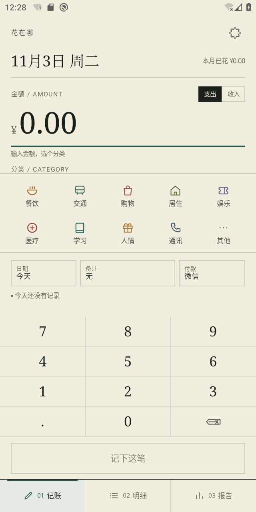
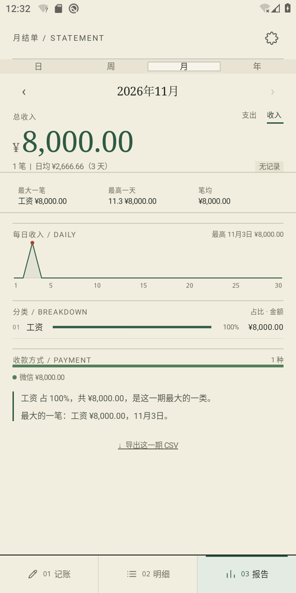
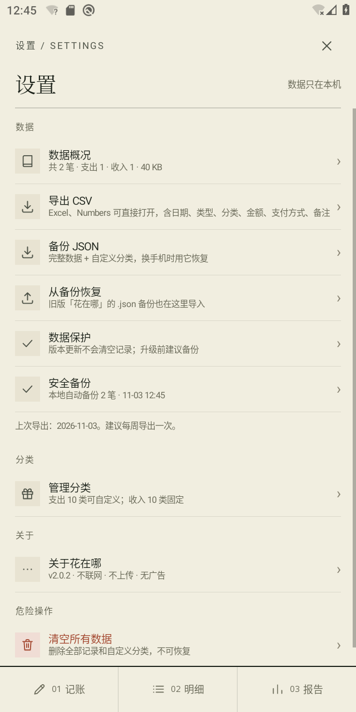

# 花在哪

> 一个只属于你的 Android 收支账本：记一笔，看清钱花在哪；数据只在手机上，CSV / JSON 随时带走。

**最新版本：v2.0.2 · Android 10+ · 离线使用 · 无账号 / 无广告 / 无联网权限**

[下载最新原生版](https://github.com/simple0926/huazaina/releases/latest) · [查看 v2.0.2 更新说明](RELEASE_NOTES-v2.0.2.md) · [校验安装包](releases/SHA256SUMS.txt)

  

## 两个版本

| | 原生版（推荐） | WebView 版（v1.2，保留） |
| --- | --- | --- |
| 安装包 | [`releases/huazaina-native-v2.0.2.apk`](releases/huazaina-native-v2.0.2.apk) | [`releases/huazaina-webview-v1.2.0.apk`](releases/huazaina-webview-v1.2.0.apk) |
| 包名 | `com.simple0926.huazaina.nativeapp` | `com.simple0926.huazaina` |
| 实现 | Java + Android View/Canvas + SQLite | 单文件 HTML/CSS/JS + Android WebView 壳 |
| 体积 | 116 KB | 70 KB |
| 启动器名 | 花在哪 原生 | 花在哪 |
| 数据 | SQLite，本地安全备份 | localStorage |

两版可以同时安装，互不覆盖。**旧版数据不会自动出现在原生版里**，需要走文末「迁移」。

首次安装建议选择原生版。WebView 版仅用于保留旧用户数据与迁移，不再增加新功能。

## v2.0.2 更新重点

- 保存、编辑、删除、导入或离开 App 时，自动写入本地安全备份。
- 数据库为空但检测到安全备份时，启动后主动提示恢复。
- 数据库升级改为只做加法迁移，并在升级前保存旧数据快照。
- 修复大额 CSV 金额、同日导出覆盖和页面重复叠加问题。

完整说明与升级注意事项见 [v2.0.2 Release Notes](RELEASE_NOTES-v2.0.2.md)。

## 它解决什么

原来的记账 App 只能记，想导出做分析就要付费；数据在别人手里，想怎么分析由不得自己。

「花在哪」只解决三件事：

1. **记一笔要快**——金额、分类，点两下就完；
2. **回看要看得懂**——日 / 周 / 月 / 年，知道钱花在了哪里、又从哪来；
3. **数据要能拿走**——CSV 直接进 Excel / WPS / Numbers，JSON 换手机完整恢复。

不是理财教练，不评判消费，不做预算提醒。

## 功能

### 记一笔

- 支出 / 收入切换；支出 10 类 + 收入 10 类
- 金额键盘、日期、备注、支付 / 收款方式
- 保存后 4 秒内可撤销；记住上次的支付方式
- 支出分类支持自定义；收入分类固定

### 明细

- 按月、按日分组，当日收支小计
- 全部 / 支出 / 收入筛选，再按分类筛选
- 搜索备注 / 分类 / 支付方式
- 点开编辑、删除；收入带 `+` 并用绿色

### 报告

- 日 / 周 / 月 / 年，可前后翻页
- 支出 / 收入两套报告
- 总收支、笔数、日均、与上一周期**同期**的涨跌
- 每日折线、最高点标注、三项 KPI
- 分类占比、支付方式占比、一句人话结论
- 导出本期 CSV

### 设置与数据

- 数据概况、导出 CSV、备份 JSON、从 JSON 恢复
- 本地安全备份：每次保存 / 编辑 / 删除 / 导入 / 离开 App 自动写一份；升级后数据库为空会提示恢复
- 自定义支出分类、清空数据（二次确认）
- 关于、版本、权限说明

## 数据与隐私

- **没有账号、没有联网权限、没有广告、没有内购**。
- 原生版 APK 只申请 `VIBRATE`；WebView 版同样只申请 `VIBRATE`。可以用 `aapt dump permissions` 自行核对。
- 记录只在本机：
  - 原生版：SQLite + App 私有目录里的 `huazaina-autosave.json`
  - WebView 版：WebView localStorage
- 导出文件写到系统 `下载/花在哪/`：
  - CSV：`花在哪-明细-YYYYMMDD.csv`、`花在哪-支出-YYYY-MM.csv`、`花在哪-收入-YYYY-MM.csv`
  - 备份：`花在哪-备份-YYYYMMDD.json`
- **卸载 App 会删除本地记录**；请定期导出 JSON。原生版的自动备份能防升级/数据库意外，但防不了卸载。

CSV 是 UTF-8 带 BOM，金额不带千分位，可直接求和 / 透视。

## 安装

1. 下载 `releases/huazaina-native-v2.0.2.apk`。
2. 传到 Android 手机，点开 APK，允许「安装未知应用」。
3. Android 10 及以上。首次打开可以「先看示例」或直接开始。

升级原生版必须继续使用同一把签名密钥，否则系统会拒绝覆盖。发布用的密钥不在此仓库中，见 [SIGNING.md](SIGNING.md)。

## 从旧版迁移

1. 打开旧版「花在哪」（没有「原生」字样）→ 设置 → **备份 JSON**。
2. 打开原生版 → 设置 → **从备份恢复** → 选这个 `.json`。
3. 核对记录、收入、自定义分类都在后，再卸载旧版。

**不要先卸载旧版**；卸载会清掉 WebView 的 localStorage。原生版无法直接读取别的 App 的私有数据。

## 构建

### WebView 版

```bash
node build.mjs
# → dist/花在哪.html，同时写入 android/assets/index.html
```

### 原生版

需要 JDK 17、Android SDK（platform 34 / build-tools 34.0.0），以及你自己的签名密钥：

```bash
export KEYSTORE_FILE=/path/to/your.keystore
export KEYSTORE_PASS=...
export KEYSTORE_ALIAS=...
export KEYSTORE_KEY_PASS=...
cd native
./build-apk.sh
# → native/release/花在哪-原生-v2.0.2.apk
```

构建脚本也读取本机的 `android/keystore.properties`（已 gitignore）。**不要把密钥和密码提交到 GitHub。**

## 测试

```bash
npm test                 # 13 项数据层测试
npm run test:ui          # 11 项浏览器主流程测试，需要 playwright-core + Chromium
```

UI 测试前先启动静态服务：

```bash
python3 -m http.server 8899 --directory dist
```

如果 Playwright 没有自带 Chromium，请通过环境变量指定本机 Chrome：

```bash
export CHROME="/Applications/Google Chrome.app/Contents/MacOS/Google Chrome"
npm run test:ui
```

原生版在 API 29 arm64 模拟器上手动走查：欢迎、记支出/撤销、收入录入、明细与收入筛选、支出/收入报告、设置、编辑、CSV/JSON 导出、自动安全备份恢复。真机触摸键盘尚未实测。

## 目录

```
huazaina/
├── src/                 WebView 版源码（core.js / app.js / app.css / app.html）
├── dist/                单文件网页版
├── android/             WebView 壳（Java + MediaStore + SAF）+ v1.2 APK
├── native/              原生版（Java / View / Canvas / SQLite）+ v2.0.2 APK
├── tests/               数据层与浏览器测试
├── tools/               截图、图标、尺寸检查脚本
├── shots/               WebView 截图
├── screenshots/         整理后的展示截图
├── design/              月结单方向、三套配色、三套 icon、logo 探索
├── design-v2/           UI/UX Pro Max 方向草稿
├── docs/                WebView v1.2 历史说明
├── releases/            对外 APK（ASCII 文件名）
├── build.mjs            WebView 单文件构建
├── package.json
└── 设计说明.md
```

## 设计

- v1.1 起使用「月结单」版式与松墨配色：暖米纸 `#F1EEE0`、墨 `#1A2018`、松墨绿 `#2F5A43`；宋体金额、发丝线、编号 + 点线。
- 图标与 logo 探索在 [`design/`](design/)，最近一版「钱去哪了」在 [`design/logo-final/`](design/logo-final/)；**尚未替换 App 图标**。
- 设计决策：[设计说明.md](设计说明.md)。

## 已知限制

- 收入分类固定 10 类；自定义收入分类未做。
- 没有深色模式、预算、周期账单、云同步、多设备、多币种。
- 原生版数据量按个人使用设计（几千条内），未做十万级分页优化。
- 原生版真机尚未实测；模拟器用 `wm size/density` 覆盖时 `adb input tap` 有坐标偏移，触摸键盘部分用例用硬件按键完成。
- WebView 版保留为 v1.2，不再加新功能。

## 版本与许可

- 最新原生版：**v2.0.2**（versionCode 202）
- WebView 版：**v1.2.0**
- 变更见 [CHANGELOG.md](CHANGELOG.md)。
- 默认 **All rights reserved**，见 [LICENSE](LICENSE)。如果要 MIT / Apache-2.0，替换 `LICENSE` 即可。
- 公开仓库表示允许查看源码，不等于授权复制、修改或再发布；具体权利以 `LICENSE` 为准。
