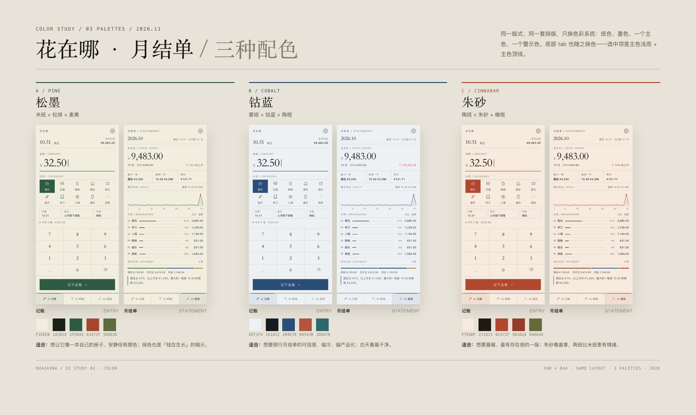
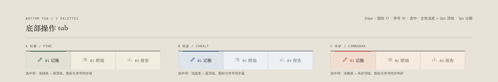

# 花在哪 · 月结单 / 三种配色

同一版式、同一套排版，只换色彩系统：纸色、墨色、一个主色、一个警示色，以及底部 tab 的选中态。三版都可以用 `entry.html?theme=pine` 这样的地址直接打开；`theme` 取 `pine` / `cobalt` / `clay`，不带参数就是原来的 `paper`。

## 三版

| | A 松墨 / PINE | B 钴蓝 / COBALT | C 朱砂 / CINNABAR |
| --- | --- | --- | --- |
| 纸 | `#F1EEE0` 米纸 | `#EEF1F4` 雾纸 | `#F7EADF` 陶纸 |
| 墨 | `#1A2018` | `#161A22` | `#211813` |
| 主色 | `#2F5A43` 松绿 | `#2B4E78` 钴蓝 | `#B2472F` 朱砂 |
| 警示 | `#A3472F` | `#B4543B` | `#963A2A` |
| 主色浅底 | 绿 8% | 蓝 8% | 陶 8% |
| 气质 | 像一本用绿墨记的册子，安静但有颜色 | 像银行月结单，冷、准、可信 | 像盖了朱印的旧账，暖、有存在感 |
| 适合 | 想要「自己的账本」感 | 想要专业、产品化、白天最干净 | 想要最暖、最有情绪的一版 |

## 换色换在哪

不只换背景和按钮。三版共用一套 token，落到这些位置：

1. **纸底与墨色**：背景、卡片、正文、次级文字、发丝线。
2. **主色**：金额下划线、输入光标、选中分类块、记下这笔、印章、封面标题下的线、每日折线、结论竖线、底部 tab 选中态。
3. **警示色**：只有「较上月 ↑」和危险操作，不和主色混用。松墨是绿主色 + 砖红警示；钴蓝是蓝主色 + 陶橙警示；朱砂是朱砂主色 + 深砖红警示。
4. **分类色**：每版 10 个分类各自压过一遍，保证在同一张纸上有区分度，又不抢主色。
5. **支付方式**：微信 / 支付宝 / 现金各一组低饱和色，和纸底同一温度。

## 底部操作 tab

- 高度 **54px**，三个等宽项，项间 **1px 分隔线**，顶部 **1px 墨线**。
- 每项：线性图标 17px + 序号 10px 等宽 + 名称 12px，水平排列，三项居中。
- 选中：**主色 8% 浅底 + 2px 主色顶线**，图标和序号同步主色，名称回到墨色。
- 未选中：墨色 60% 的次级文字，纸底。
- 54px 是触控高度，整个 tab 都是可点区域；序号不是单独按钮，避免误触。
- 没有做中间凸起的「记一笔」FAB：记账页本身已经有一个整宽的「记下这笔」，再加一个会重复。若你想要 FAB 版，可以另出一版。

## 对比度

主色对纸底、纸底字对主色都按 4.5:1 校过；松墨与钴蓝更宽裕，朱砂在 4.6–4.7 附近（15px 主按钮文字仍可读，但不建议再调浅）。次级文字（`--ink-3`）在 4.6–5:1。

## 怎么选

- 想「有颜色但仍然是账本」→ **A 松墨**（我的推荐）
- 想「像一份正式的银行文件」→ **B 钴蓝**
- 想「暖、有情绪、像盖章的旧账」→ **C 朱砂**

**已选择 A 松墨**，并已落到应用 v1.2：纸底、主色、分类色、支付色、底部 tab 选中态全部为松墨。
